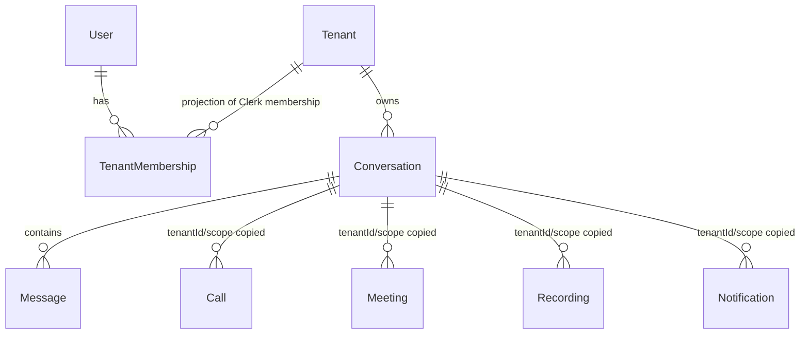
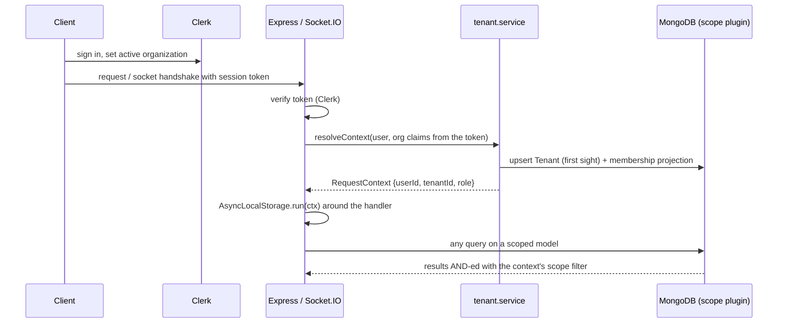

# Multi-tenancy architecture

Status: Phase 2–3 implemented in `webrtc-BE` (backend only). Frontend workspace switching is Phase 6.

## Decisions

| Decision | Choice | Why |
| --- | --- | --- |
| Stack | Keep Express 4 + Mongoose + Socket.IO + mediasoup | Working system; NestJS migration would be a rewrite |
| Identity & membership | Clerk users + **Clerk Organizations** (membership, invitations, roles, active org) | Avoids building and securing invitation / membership flows |
| Authorization | Our backend (MongoDB) | Clerk membership alone never grants access to a resource |
| Isolation strategy | Shared collections + enforced `tenantId` scoping | Matches current MongoDB setup; no physical-isolation requirement identified |
| Existing data | Stays global (`tenantId: null`) | No automatic assignment to any tenant |

## Communication scopes

Every conversation has a `scope`, set by the server at creation (never from input):

| Scope | `tenantId` | Who can see it |
| --- | --- | --- |
| `global` | `null` (or missing on legacy data) | Members, while in the **global** context |
| `tenant` | the workspace | Members, while in **that** workspace |
| `external` | the owning workspace | Workspace members in that workspace, plus the listed `externalParticipants` (guests) from any context |

Records that belong to a conversation — calls, meetings, recordings, notifications, saved messages — copy the conversation's `tenantId` / `scope` when created. Messages are not stamped; they are only reachable through their (scoped) conversation.

## Data model

- **Tenant** (`src/models/tenantModel.ts`): `clerkOrgId` (unique, stable external reference), `name`, `slug`, `status` (`active` / `suspended`), `policies`. Created automatically the first time a session for that Clerk organization is seen, with every external-sharing policy **off**.
- **TenantMembership** (`src/models/tenantMembershipModel.ts`): `(tenantId, userId)` unique, `role`, `status`, `lastSeenAt`. A *projection* refreshed on use; used for the workspace directory and the "only workspace members can be added" rule. It is **not** the access authority — see below.
- **Conversation** gains `tenantId`, `scope`, `externalParticipants`. **Call / Meeting / Recording / Notification / SavedMessage** gain `tenantId`, `scope`.
- **User** gains `globalDiscoverable` (default `true`, settable via `PATCH /web/user/profile`).

## Roles and permissions

Role comes from the verified session's active-organization role:

| Clerk role | Our role |
| --- | --- |
| `org:owner` (custom role — must be created in Clerk) | owner |
| `org:admin` | admin |
| any other `org:*` | member |
| (listed in an external conversation) | guest — access to that conversation only |

Permission matrix (`can()` in `src/tenancy/tenant.service.ts`):

| Permission | owner | admin | member | guest |
| --- | --- | --- | --- | --- |
| read workspace / directory | ✓ | ✓ | ✓ | – |
| change policies | ✓ | ✓ | – | – |
| start external conversation | ✓* | ✓* | ✓* if `membersCanStartExternal` | – |

\* only when `allowExternalChat` is on.

**Platform admins** (`PLATFORM_ADMIN_CLERK_IDS`) are recognised in the context but get **no** implicit access to tenant data. No platform-admin endpoints exist yet.

## Tenant policies

`allowExternalChat`, `allowExternalCalls`, `allowExternalFiles`, `membersCanStartExternal` — all default `false`. Enforced on the server when sending messages, sending files (socket and `/upload`) and starting calls in external conversations.

## Context propagation

- **HTTP**: `verifyToken` resolves the context and runs the rest of the request inside it (`runWithContext`). Multer completes on stream callbacks, so `uploadSingle` re-enters the context after parsing.
- **Socket.IO**: the context is resolved once at the handshake. A `socket.use` middleware runs every incoming event inside it, and gateway registration (connect-time work) runs inside it too. **Switching workspace = reconnect with a token for the new organization.**
- **Data layer** (`src/tenancy/scope.ts`): a Mongoose plugin AND-s every `find / findOne / count / distinct / update / delete / findOneAnd*` with the context filter and prepends a `$match` to aggregations. Without a user context (migrations, timers, recording processing) queries are unfiltered, as before; `runAsSystem()` is used for deliberate cross-scope internal lookups.
- **Outgoing socket events** (`src/realtime/io.ts`): events about a conversation are delivered to a user's socket only if that socket's workspace can see the conversation (`visibleIn`). A conversation's scope is immutable, so it is cached.

## Endpoints added

All take the workspace from the session; none accept a tenant id.

| Method | Path | Purpose |
| --- | --- | --- |
| GET | `/tenant/current` | Active workspace, my role, policies, my permissions |
| PATCH | `/tenant/current/policies` | Owner/admin: change policies (strict boolean validation) |
| GET | `/tenant/workspaces` | Workspaces I've been seen in |
| GET | `/directory` | People I can contact in the active context |
| POST | `/tenant/external-conversations` | Start an external 1:1 with a non-member (policy-gated) |

Changed behaviour: `GET /web/users`, `GET /web/users/except-current` and `GET /web/user/:id` now return the active context's directory, without email for other people.

## Phase 4A additions

- **Fail-closed context:** user or explicit system context is required for scoped models (`docs/security/fail-closed-tenant-context.md`).
- **Clerk webhooks** keep tenants and memberships in sync, and removal tombstones revoke access immediately (`docs/integrations/clerk-webhooks.md`).
- **Messages** are scope-stamped like the other conversation records.
- **`/v1` API** with validation, a standard envelope, cursor pagination and generated OpenAPI (`docs/api/v1.md`).
- **Graceful shutdown** (`src/shutdown.ts`).
